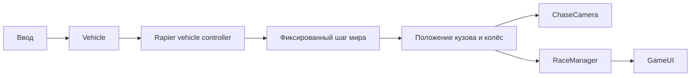

# Архитектура

## Клиент

`Game` управляет жизненным циклом сцены. `PhysicsWorld` создаёт мир Rapier и выполняет фиксированные шаги. `Vehicle` переводит команды ввода в команды RayCastVehicleController и синхронизирует визуальную модель. `TrackScene` создаёт окружение, дорогу, барьеры и контрольные точки. `RaceManager` отвечает за состояние заезда и порядок контрольных точек. `ChaseCamera` сглаживает следование, расстояние и угол обзора. `GameUI` связывает HUD и экраны с игровыми событиями.

### Физика

Текущая интеграция Rapier 0.19.3 использует `World.createVehicleController(chassis)`, четыре `addWheel(...)`, setters для двигателя/тормозов/руления и `updateVehicle(dt, QueryFilterFlags.EXCLUDE_DYNAMIC)` до `world.step()`. За один кадр накапливается время; симуляция делает шаги 1/60 секунды с ограничением количества догоняющих шагов. `PhysicsWorld` передаёт `EventQueue` в каждый шаг и публикует контактные силы обычными JS-объектами через `subscribeContactForces(listener)`.

### Данные

`frontend/src/vehicle/vehicleCatalog.json` и `frontend/src/tracks/trackCatalog.json` содержат исходные каталоги. Фронтенд импортирует их как данные сборки; Flask читает те же JSON-файлы. Заглушка `model: null` разрешена только при наличии соответствующего поля `fallback`.

## Сервер

Flask создаёт схему SQLite при запуске приложения. Репозитории пока реализованы компактно в сервисном слое. API создаёт локальный профиль без регистрации, выдаёт каталоги, проверяет покупку машины и не позволяет выбрать не принадлежащую игроку машину. Серверная проверка результатов гонок и наград появится вместе с карьерной фазой.

## Поток заезда

## Управление ресурсами

Сцена хранит свои объекты Three.js; игровой объект останавливает цикл рендера, снимает обработчики ввода/изменения размера, освобождает рендерер и мир физики. При переходе к загрузке GLB или звука их ресурсы должны освобождаться тем модулем, который их создал.
